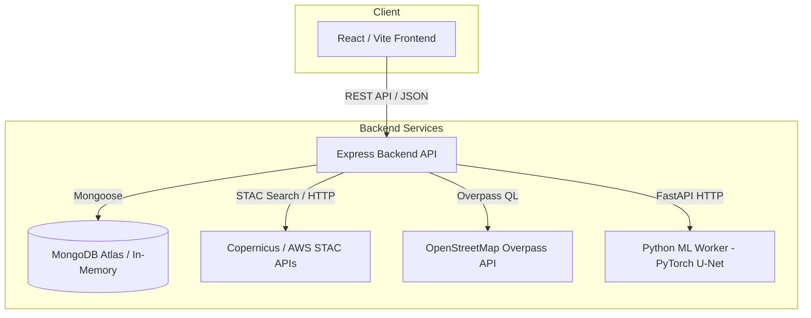

# FloodWatch — Mapping Flood Damage from Space

**Multimodal AI Hackathon 2026 — Track B Submission**

[]()
[]()
[]()
[]()
[-purple.svg)]()

FloodWatch is an advanced geospatial web platform designed to accelerate flood impact assessment and disaster response. By combining real-time Copernicus satellite STAC discovery, pre-event OpenStreetMap (OSM) infrastructure data, road network connectivity analysis, and transparent situational reporting, FloodWatch provides emergency responders with actionable, evidence-based intelligence during severe weather and flooding events.

---

## 🚨 Problem Statement

When catastrophic floods strike, disaster management authorities, humanitarian organizations, and emergency responders face severe information bottlenecks:
- **Limited Ground Visibility:** Rising waters and washed-out roads prevent immediate on-the-ground reconnaissance.
- **Delayed Intelligence:** Traditional damage assessment takes days or weeks to compile.
- **Data Fragmentation:** Satellites, hydrological models, and infrastructure registries are rarely integrated into a single cohesive operational dashboard.

---

## 💡 Our Solution

FloodWatch bridges this gap by offering an integrated web-based GIS decision-support system. Users can select any geographic area of interest (AOI) and event date, query multi-temporal satellite observations from open science STAC repositories, overlay pre-event critical infrastructure, and generate standardized emergency situation reports.

*Note on Transparency:* FloodWatch adheres to strict data integrity standards. Genuine capabilities are fully operational, while features requiring unprovided external model weights or external APIs are explicitly marked **UNAVAILABLE** rather than simulated with fabricated data.

---

## ✨ Key Features & Implementation Status

| Feature | Status | Description |
| :--- | :--- | :--- |
| **Interactive Map & AOI Selection** | **IMPLEMENTED** | Leaflet-based map with OpenStreetMap tiles, Nominatim global geocoding, and interactive bounding box AOI definition. |
| **Satellite Scene Discovery** | **IMPLEMENTED** | Queries official Copernicus Data Space and AWS Earth Search STAC APIs for Sentinel-2 optical and Sentinel-1 SAR observations. |
| **Raster Asset Inspection** | **IMPLEMENTED** | Secure asset streaming via rasterio `/vsicurl/` with GDAL TLS configuration. |
| **AI Flood Segmentation** | **UNAVAILABLE / GATED** | PyTorch U-Net architecture (`FloodUNet`) and FastAPI worker (`ml-worker/`). Requires user-supplied model weights (`models/sen1floods11_unet.pt`). |
| **OSM Infrastructure Exposure** | **IMPLEMENTED** | Overpass API integration to retrieve pre-event roads, bridges, hospitals, and schools within the selected AOI. |
| **Road Network Connectivity** | **IMPLEMENTED** | Graph analysis evaluating access routes and identifying potentially cut-off settlements. |
| **Situation Reporting** | **IMPLEMENTED** | Automated situation brief generation with mandatory Copernicus WorldDEM and OpenStreetMap attributions. |
| **Database & Session Handling** | **IMPLEMENTED** | MongoDB Atlas integration via Mongoose, with robust in-memory fallback when connection strings are unconfigured. |

---

## 🏗️ System Architecture



---

## 🛠️ Technology Stack

- **Frontend:** React 18, TypeScript, Vite, Tailwind CSS, Lucide React, React-Leaflet, Leaflet.
- **Backend:** Node.js, Express, TypeScript, Mongoose, Dotenv, Cors.
- **Geospatial & Satellite Data:** Copernicus Data Space Ecosystem STAC API, AWS Earth Search STAC API, Rasterio, GDAL.
- **Infrastructure & Maps:** OpenStreetMap (OSM) Overpass API, Nominatim Geocoder, Leaflet Tile Layers.
- **AI & Machine Learning (Gated):** Python 3.10, FastAPI, PyTorch, Torchvision, NumPy.
- **Database:** MongoDB Atlas (Optional; includes automated in-memory fallback).

---

## 🗺️ End-to-End Workflow

1. **Open FloodWatch:** Launch the web application via the local development server.
2. **Search Location:** Enter any location (e.g., *"Trishuli, Nepal"* or *"Uttarakhand, India"*) into the search bar.
3. **Select AOI:** The map recenters, and the bounding box Area of Interest updates automatically.
4. **Discover Satellite Scenes:** Query pre- and post-event Sentinel-1 SAR and Sentinel-2 optical observations via STAC.
5. **Inspect Infrastructure:** View pre-event bridges, roads, and emergency facilities retrieved via OpenStreetMap.
6. **Assess Connectivity:** Review road network accessibility and potential isolation risks.
7. **Generate Situation Report:** Export a standardized operational brief citing all required data attributions.

---

## 🚀 Installation and Setup

### Prerequisites
- **Node.js** (v18 or higher)
- **Python** (v3.10 or higher — *optional, required only for local ML inference worker*)
- **MongoDB Atlas** connection string *(optional — falls back to in-memory storage if omitted)*

### 1. Clone the Repository & Install Dependencies
```bash
git clone https://github.com/anthropics/claude-code.git # or your repository URL
cd fw
npm install
```

### 2. Configure Environment Variables
Create a root-level `.env` file (refer to `.env.example`):
```env
PORT=5000
MONGODB_URI=mongodb+srv://<username>:<password>@cluster0.xxxx.mongodb.net/floodwatch?retryWrites=true&w=majority
NODE_ENV=development
STAC_API_URL=https://stac.dataspace.copernicus.eu/v1
```

### 3. Startup Commands (Windows PowerShell)
Open **two or three separate PowerShell windows** in the project root (`C:\Users\Dell\fw`):

#### Terminal 1: Backend API Server
```powershell
npm run server
```
*(Or for hot-reloading development mode:* `npm run server:dev` *)*

#### Terminal 2: Python ML Worker (Optional / Gated)
```powershell
cd ml-worker
python -m venv venv
./venv/Scripts/Activate.ps1
pip install -r requirements.txt
python main.py
```

#### Terminal 3: Frontend Development Server
```powershell
npm run dev
```
Then open your browser to **http://localhost:3000** (or the port specified by Vite).

---

## 🧪 Testing & Verification

Run the production frontend build to verify TypeScript compilation and bundle integrity:
```bash
npm run build
```
Run backend verification test scripts:
```bash
node server/verify-backend.ts
node server/verify-phases4-5-6.ts
```

---

## 📋 Data Sources & Attributions

- **Sentinel Satellite Data:** Contains modified Copernicus Sentinel data (2026), accessed via Copernicus Data Space Ecosystem and AWS Earth Search STAC.
- **Elevation Model:** Produced using Copernicus WorldDEM-30 © DLR e.V. 2010–2014 and © Airbus Defence and Space GmbH 2014–2018.
- **Map & Infrastructure Data:** © OpenStreetMap contributors.
- **Validation Standard:** Official Copernicus EMS reference maps (e.g., EMSR927) are used strictly for independent validation, never as algorithmic inputs.
